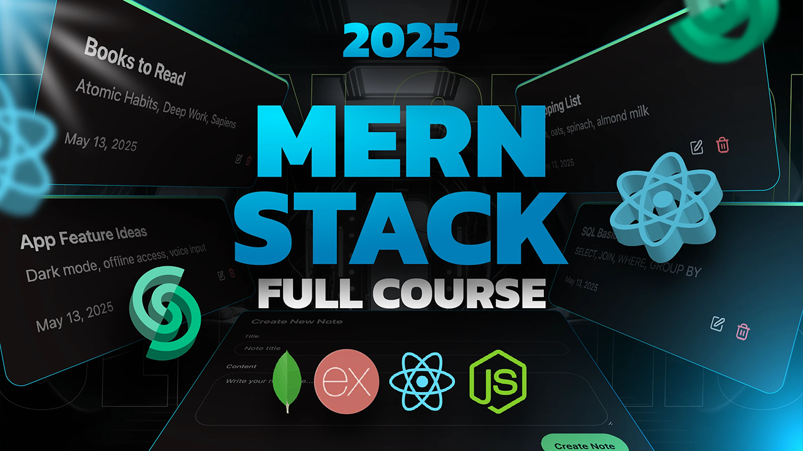

<h1 align="center">📝 ThinkBoard — MERN Stack Note Taking App ✨</h1>

<p align="center">
  A sleek, full-stack note-taking application built with the MERN stack featuring dynamic Upstash Redis rate limiting and a modern glassmorphic UI.
</p>

<p align="center">
  <a href="https://your-render-app-url.onrender.com"><strong>🌐 Live Demo</strong></a>
</p>



---

## ✨ Features & Highlights

- 🧱 **Full-Stack MERN Architecture:** Built with MongoDB, Express.js, React, and Node.js.
- 🎨 **Modern Dark UI:** Glassmorphism components built with Tailwind CSS, Lucide icons, and custom confirmation modals.
- ⚙️ **Upstash Redis Rate Limiting:** Dynamic proxy-aware IP rate limiting (`@upstash/ratelimit`) to prevent API abuse.
- ⚡ **RESTful API:** Complete CRUD operations for notes (Create, Read, Update, Delete) with HTTP error handling.
- 📱 **Fully Responsive:** Optimized for desktop, tablet, and mobile displays.

---

## 🧪 Environment Variables (`.env`)

Create a `.env` file inside your backend directory with the following variables:

```env
PORT=5001
MONGO_URI=<your_mongodb_connection_string>

UPSTASH_REDIS_REST_URL=<your_upstash_redis_rest_url>
UPSTASH_REDIS_REST_TOKEN=<your_upstash_redis_rest_token>

NODE_ENV=development
```
